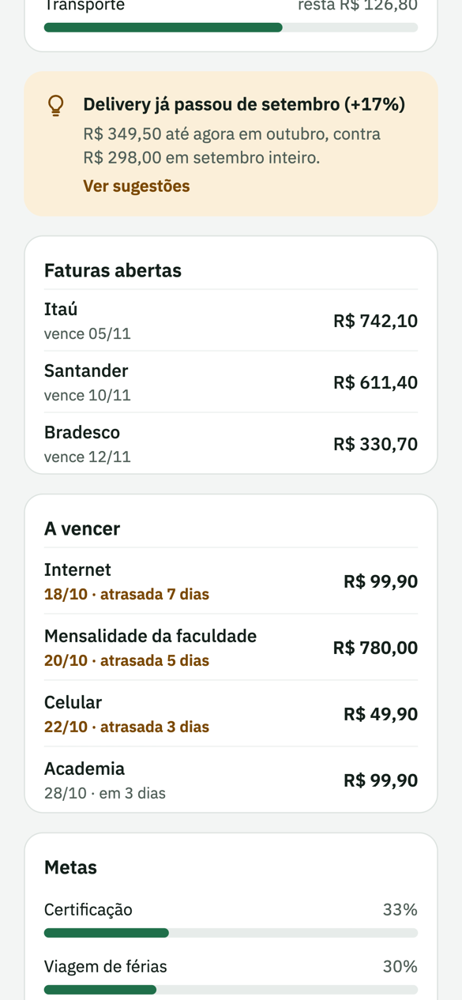
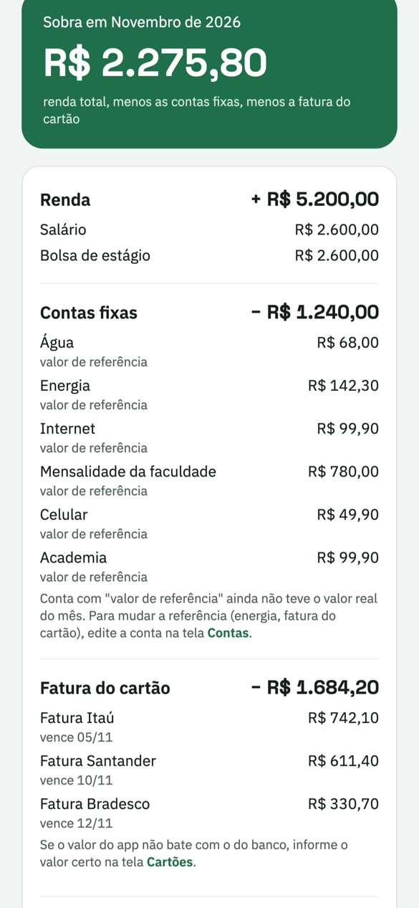
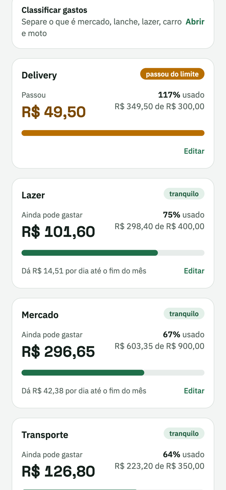
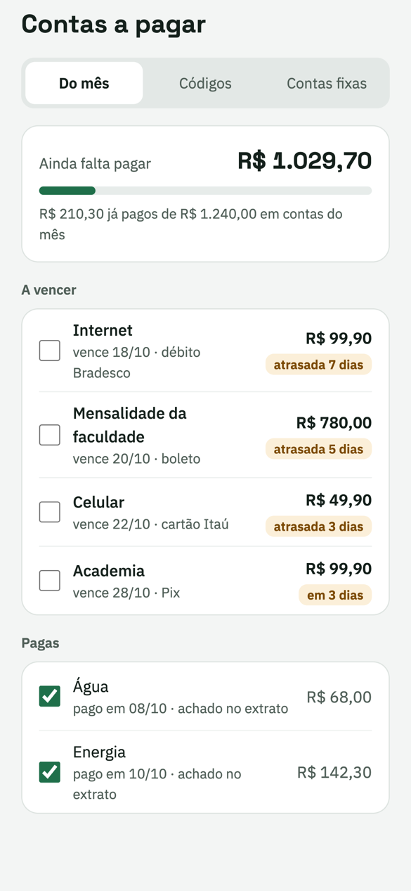
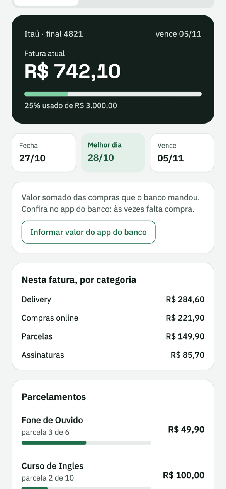

# Gestor de Finanças

Aplicativo web (PWA) de finanças pessoais que junta contas, cartões, contas a pagar, metas e investimentos
numa tela só, com os dados vindos dos bancos pelo **Open Finance** (Pluggy).

> Projeto pessoal em uso real. As imagens abaixo usam **dados de exemplo** (`npm run db:exemplo`).

| Início | Sobra do mês | Limites |
|:--:|:--:|:--:|
|  |  |  |

| Contas a pagar | Cartões |
|:--:|:--:|
|  |  |

## O que faz

- **Início:** saldo nas contas, entradas e saídas do mês, faturas abertas e uma projeção do que vai sobrar até o fim do mês.
- **Sobra do mês:** renda total menos as contas fixas menos a fatura do cartão, mês a mês, sem médias nem projeções.
- **Limites por categoria:** quanto ainda dá para gastar, quanto por dia, e aviso quando passa do teto.
- **Contas a pagar:** contas fixas e avulsas, com o pagamento reconhecido automaticamente no extrato.
- **Cartões:** fatura atual, melhor dia de compra, gastos por categoria e parcelamentos.
- **Sincronização:** o servidor confere de hora em hora se algum banco tem dado novo; também dá para pedir dados novos manualmente.

## Tecnologias

| Camada | Tecnologias |
|---|---|
| Back-end | TypeScript, NestJS, Prisma, PostgreSQL 17 |
| Front-end | React, Vite, Tailwind CSS, PWA |
| Dados bancários | Open Finance via Pluggy |
| Infraestrutura | Docker Compose, hospedagem própria acessível por rede privada (Tailscale) |
| Testes | Jest |

## Decisões de projeto

- **Login só com passkey** (Face ID / Touch ID): não existe senha. Aparelhos novos só são cadastrados por quem já entrou.
- **Sessão segura:** o token fica só como hash no banco, o cookie é `httpOnly` e `sameSite=strict`, e as rotas têm limite de tentativas.
- **Dado financeiro nunca fica em cache offline:** o service worker não guarda nada de `/api`.
- **Acesso de envio:** uma pessoa convidada pode apenas mandar boletos e Pix para você pagar, sem ver saldo, extrato nem cartões.
- **Cálculos testados:** regras como a sobra do mês e o fechamento de fatura ficam em funções puras, com testes.

## Como rodar

```sh
docker compose up -d                 # Postgres na porta 5434 (só local)
cd backend && npm install
npx prisma migrate dev               # cria as tabelas
npm run db:exemplo                   # dados de exemplo
npm run start:dev                    # API em http://127.0.0.1:3100/api

cd ../web && npm install && npm run dev   # app em http://localhost:5173
```

Antes da primeira vez, copie `.env.example` para `.env` (na raiz e em `backend/`) e troque a senha do banco.
No primeiro acesso, o app pede o `CODIGO_CADASTRO` definido em `backend/.env` para cadastrar a primeira passkey.
Para usar dados reais, é preciso uma conta no Pluggy (variáveis `PLUGGY_CLIENT_ID`, `PLUGGY_CLIENT_SECRET` e `PLUGGY_ITENS`).

```sh
cd backend && npm test
```

## Licença

MIT.
